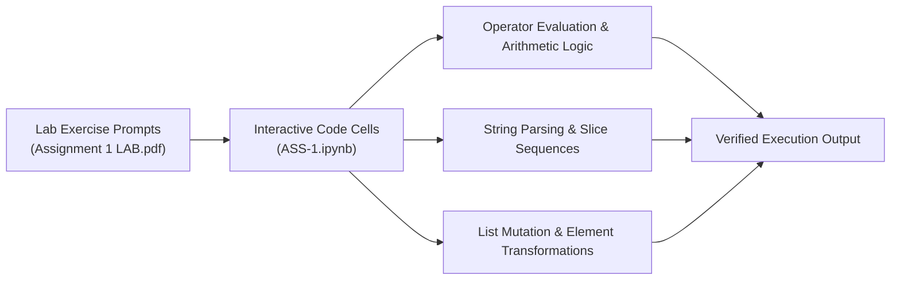

<p align="center">
  
</p>

<p align="center">
  
  
  
  
</p>

<a id="overview"></a>
## 📖 Executive Summary & Overview

Foundational computer science pedagogy requires hands-on experimentation with operator precedence, string immutability, and dynamic array reallocation. Without practical verification of arithmetic operators, bitwise logic, and slice indexing, programming errors frequently compound in higher-level numerical modules.

The **Python Core Laboratory 1** (`Python-Assignment-1`) provides a documented laboratory submission for BCA Python Programming coursework. The repository contains the computational notebook `ASS-1.ipynb` and its formal academic report `Assignment 1(LAB).pdf`, demonstrating hands-on mastery of arithmetic operations, string transformations, and list manipulations.

<a id="toc"></a>
## 📑 Table of Contents

- [📖 Executive Summary & Overview](#overview)
- [🎯 Key Features & Capabilities](#features)
- [🏗️ System Architecture & Pipeline](#architecture)
- [🛠️ Tech Stack Breakdown](#tech-stack)
- [⚙️ Reproducible Quickstart & Setup](#setup)
- [📁 Project Directory Layout](#project-layout)
- [👨‍💻 Author & Contributions](#author)

<a id="features"></a>
## 🎯 Key Features & Capabilities

- **Arithmetic & Logical Operations:** Addition, subtraction, multiplication, floor division (`//`), modulo (`%`), and exponentiation (`**`).
- **String Manipulation:** Indexing, negative slicing, concatenation, string interpolation, and standard string methods (`split`, `strip`, `join`).
- **Dynamic List Operations:** Element appending, insertion, popping, slicing, and nested list traversal.
- **Academic Verification:** Complete PDF laboratory documentation with input cases, console outputs, and theoretical commentary.

<a id="architecture"></a>
## 🏗️ System Architecture & Pipeline



<a id="tech-stack"></a>
## 🛠️ Tech Stack Breakdown

| Technology | Category | Detail |
| :--- | :--- | :--- |
| **Language** | Python 3.x | Core programming language |
| **Notebook Runtime** | Jupyter / Google Colab | Interactive cell-by-cell execution |
| **Documentation** | Academic Lab Report (`.pdf`) | Formal problem statements, code, and output logs |

<a id="setup"></a>
## ⚙️ Reproducible Quickstart & Setup

### Prerequisites
- Python 3.8+ and Jupyter Notebook installed

```bash
# 1. Clone repository
git clone https://github.com/Amaraiah11/Python-Assignment-1.git
cd Python-Assignment-1

# 2. Launch notebook
jupyter notebook ASS-1.ipynb
```

<a id="project-layout"></a>
## 📁 Project Directory Layout

```text
Python-Assignment-1/
├── ASS-1.ipynb                # Interactive Jupyter notebook with laboratory solutions
├── Assignment 1(LAB).pdf      # Formal graded academic laboratory report
└── README.md                  # Comprehensive laboratory documentation
```

<a id="author"></a>
## 👨‍💻 Author & Contributions

This project is developed and maintained with high technical rigour by **Amaraiah C**, Software Engineer and Data Analytics Practitioner studying Bachelor of Computer Applications (BCA) at Alliance University.

- 🌐 **GitHub:** [@Amaraiah11](https://github.com/Amaraiah11)
- 💼 **LinkedIn:** [Connect on LinkedIn](https://www.linkedin.com/in/amaraiah-c/)
- 📧 **Institutional Contact:** `camaraiahBCA24@ced.alliance.edu.in`

### 🤝 Contribution Guidelines
Contributions, bug reports, and architectural discussions are welcome!
1. **Fork** the repository: `https://github.com/Amaraiah11/Python-Assignment-1`
2. **Branch**: `git checkout -b feature/your-feature-name`
3. **Commit**: `git commit -m "feat: enhance feature logic"`
4. **Push**: `git push origin feature/your-feature-name`
5. **Open Pull Request** against the `main` branch.

---

<p align="center">
  <b>⭐ If this codebase or documentation assisted your engineering workflows, please star the repository! ⭐</b>
</p>

<p align="center">
  
</p>
