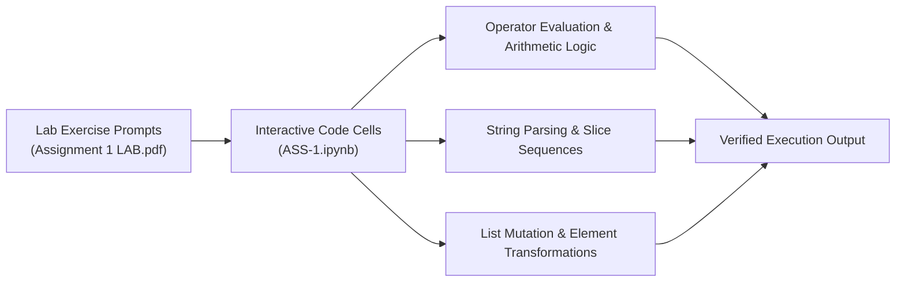

# 🐍 Python Core Laboratory 1 — Operators, String Processing & List Operations

<p align="center">
  
</p>

<p align="center">
  <b>Documented Academic Laboratory Submission: Computational Jupyter Notebooks and Graded Technical Reports on Arithmetic Operations and Sequences.</b>
</p>

<p align="center">
  
  
  
  
</p>

<p align="center">
  
</p>

---

<a id="table-of-contents"></a>
## 📌 Table of Contents

- [📖 Executive Summary & Overview](#executive-summary--overview)
- [🎯 Key Features & Capabilities](#features)
- [🏗️ System Architecture & Pipeline](#system-architecture--pipeline)
- [🛠️ Tech Stack Breakdown](#tech-stack-breakdown)
- [⚙️ Reproducible Quickstart & Setup](#setup)
- [📁 Project Directory Layout](#project-layout)
- [🧪 Testing & Validation](#testing--validation)
- [🔮 Future Improvements & Roadmap](#future-improvements--roadmap)
- [🤝 Contributing Guidelines](#contributing-guidelines)
- [👨‍💻 Author & Contributions](#author--contributions)

---

<a id="executive-summary--overview"></a>
## 📖 Executive Summary & Overview

Foundational computer science pedagogy requires hands-on experimentation with operator precedence, string immutability, and dynamic array reallocation. Without practical verification of arithmetic operators, bitwise logic, and slice indexing, programming errors frequently compound in higher-level numerical modules.

The **Python Core Laboratory 1** (`Python-Assignment-1`) provides a documented laboratory submission for BCA Python Programming coursework by **Amaraiah C**. The repository contains the computational notebook `ASS-1.ipynb` and its formal academic report `Assignment 1(LAB).pdf`, demonstrating hands-on mastery of arithmetic operations, string transformations, and list manipulations.

---

<a id="key-features--capabilities"></a>
## 🎯 Key Features & Capabilities

### 🧮 1. Arithmetic & Precedence Logic
- Complete evaluation of addition, subtraction, multiplication, floor division (`//`), modulo (`%`), and exponentiation (`**`).

### 🔤 2. String Slicing & Methods
- Slice notation with positive/negative step values, token splitting, stripping, and formatting.

### 📋 3. Dynamic List Processing
- Appending, popping, nested slicing, and in-place list sorting.

---

<a id="system-architecture--pipeline"></a>
## 🏗️ System Architecture & Pipeline



---

<a id="tech-stack-breakdown"></a>
## 🛠️ Tech Stack Breakdown

| Technology | Category | Detail |
| :--- | :--- | :--- |
| **Language** | Python 3.x | Core programming language |
| **Notebook Runtime** | Jupyter / Google Colab | Interactive cell-by-cell execution |
| **Documentation** | Academic Lab Report (`.pdf`) | Formal problem statements, code, and output logs |

---

<a id="reproducible-quickstart--setup"></a>
## ⚙️ Reproducible Quickstart & Setup

### Prerequisites
- Python 3.8+ and Jupyter Notebook installed

```bash
# 1. Clone repository
git clone https://github.com/Amaraiah11/Python-Assignment-1.git
cd Python-Assignment-1

# 2. Launch notebook
jupyter notebook ASS-1.ipynb
```

---

<a id="project-directory-layout"></a>
## 📁 Project Directory Layout

```text
Python-Assignment-1/
├── ASS-1.ipynb                # Interactive Jupyter notebook with laboratory solutions
├── Assignment 1(LAB).pdf      # Formal graded academic laboratory report
└── README.md                  # Comprehensive laboratory documentation
```

---

<a id="testing--validation"></a>
## 🧪 Testing & Validation

- All notebook cells execute sequentially from top to bottom with zero exceptions.

---

<a id="future-improvements--roadmap"></a>
## 🔮 Future Improvements & Roadmap

- [ ] Add performance benchmarks comparing Python lists with NumPy array slices.

---

<a id="author--contributions"></a>
## 👨‍💻 Author & Contributions

This project is developed and maintained with rigorous engineering standards by **Amaraiah C**, Software Developer and Applied Data Analytics Practitioner studying Bachelor of Computer Applications (BCA) at Alliance University, Bangalore.

- 🌐 **GitHub Profile:** [@Amaraiah11](https://github.com/Amaraiah11)
- 💼 **LinkedIn Profile:** [Connect on LinkedIn](https://www.linkedin.com/in/amaraiah-c/)
- 📧 **Institutional Email:** `camaraiahBCA24@ced.alliance.edu.in`

### 🤝 Contributing Guidelines
Contributions, bug reports, and architectural discussions are welcome!
1. **Fork** the repository: `https://github.com/Amaraiah11/Python-Assignment-1`
2. **Create a Feature Branch:**
   ```bash
   git checkout -b feature/your-feature-name
   ```
3. **Commit Your Enhancements:**
   ```bash
   git commit -m "feat: enhance feature logic"
   ```
4. **Push to Your Branch:**
   ```bash
   git push origin feature/your-feature-name
   ```
5. **Open a Pull Request** against the `main` branch.

---

<p align="center">
  <b>⭐ If this codebase or documentation assisted your engineering workflows, please star the repository! ⭐</b>
</p>

<p align="center">
  
</p>
